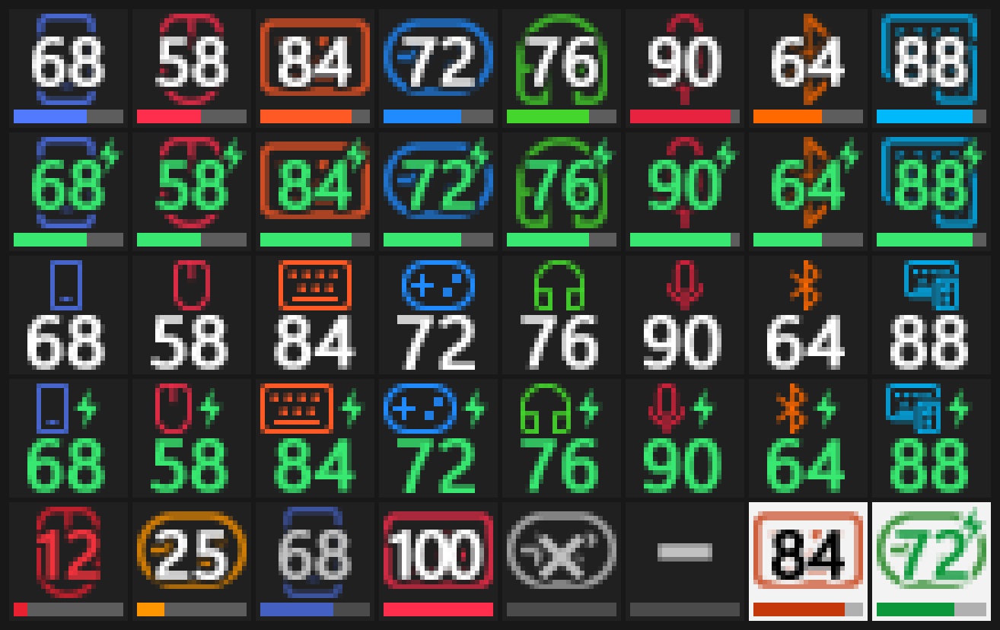

# BatteryHub 🔋

[](https://www.gnu.org/licenses/gpl-3.0)
[](https://github.com/AnhHoang61/BatteryHub/releases)
[](https://github.com/AnhHoang61/BatteryHub)
[](https://github.com/AnhHoang61/BatteryHub/releases/tag/v1.1.0)

> **BatteryHub** là tiện ích mã nguồn mở siêu nhẹ dành cho Windows 10 và 11, hiển thị thời lượng pin thời gian thực của các thiết bị không dây (chuột, bàn phím, tai nghe gaming, tay cầm chơi game) trực tiếp trên thanh tác vụ (Taskbar) hoặc khay hệ thống (System Tray).
>
> 🚀 **Không cần chạy các phần mềm nặng**: Tạm biệt Logitech G HUB, Razer Synapse, SteelSeries GG hay Corsair iCUE chỉ để xem % pin!

---



## 🌟 Tính Năng Nổi Bật (Key Features)

- **Cực kỳ nhẹ & tiết kiệm tài nguyên**:
  - Dung lượng file chỉ ~1 MB.
  - Sử dụng chỉ **~2 MB RAM**, mức sử dụng **CPU xấp xỉ 0%**.
  - Không sinh tiến trình chạy ngầm vô ích, không thu thập dữ liệu người dùng (zero telemetry).
- **Hiển thị mượt mà với 4× SSAA (Super-Sampling Anti-Aliasing)**:
  - Sử dụng font chữ hệ thống `Segoe UI Variable Text` kết hợp icon vector `Segoe Fluent Icons`.
  - Khử răng cưa 4 lần giúp các con số và biểu tượng trên khay hệ thống sắc nét, rõ ràng kể cả trên màn hình độ phân giải cao 2K/4K.
- **Cảnh báo pin thông minh & Trạng thái sạc**:
  - 🔴 **Màu đỏ**: Báo động khi pin xuống mức thấp (≤ 15%).
  - ⚡ **Tia sét xanh neon**: Hiển thị ngay khi thiết bị đang cắm sạc pin.
  - 💤 **Làm mờ thông minh**: Tự động làm mờ mức pin của các thiết bị đang ở chế độ ngủ (sleep) để tiết kiệm pin.
- **Hỗ trợ hơn 50+ thương hiệu thiết bị**:
  - **Chuột & Bàn phím**: Logitech (Unifying, Lightspeed, Bolt), Razer, SteelSeries, Corsair, HyperX, MonsGeek, Keychron, Akko, VGN/VXE, Attack Shark, AULA, Darmoshark, v.v.
  - **Tay cầm chơi game**: Xbox Wireless Controller, Xbox 360 / One / Series X|S, Sony PlayStation DualSense / DualShock 4, Nintendo Switch Pro Controller, v.v.
  - **Tai nghe gaming**: Tích hợp module **HeadsetControl 4.3.0** hỗ trợ đầy đủ các dòng tai nghe không dây phổ biến.
  - **Bluetooth LE**: Mọi thiết bị Bluetooth tiêu chuẩn được Windows ghi nhận thông tin pin.
  - **Windows Phone Link**: Đồng bộ mức pin điện thoại Android (Xiaomi, Samsung, OPPO, vivo, OnePlus, v.v.).

---

## 📥 Tải Về & Cài Đặt (Download & Installation)

Bạn có thể tải phiên bản mới nhất tại mục [Releases](https://github.com/AnhHoang61/BatteryHub/releases):

| Tệp tải về | Mô tả |
|---|---|
| **[BatteryHub-Setup-1.1.0.exe](https://github.com/AnhHoang61/BatteryHub/releases/download/v1.1.0/BatteryHub-Setup-1.1.0.exe)** | Trình cài đặt tự động (Khuyên dùng). Tự động tạo shortcut và tùy chọn khởi động cùng Windows. |
| **[BatteryHub-1.1.0-portable.zip](https://github.com/AnhHoang61/BatteryHub/releases/download/v1.1.0/BatteryHub-1.1.0-portable.zip)** | Bản Portable không cần cài đặt. Giải nén vào một thư mục cố định và mở `BatteryHub.exe` để sử dụng. |

### 💡 Mẹo đưa biểu tượng ra thanh Taskbar:
1. Mở `BatteryHub.exe`.
2. Ở góc dưới bên phải màn hình (cạnh đồng hồ), bấm vào **mũi tên hướng lên `^`** (Show hidden icons).
3. Tìm biểu tượng số % pin của thiết bị, **nhấn giữ chuột trái và kéo thả ra thanh Taskbar**.
4. Chuột phải vào biểu tượng bất kỳ lúc nào để:
   - Đổi bố cục hiển thị (Dọc / Ngang / Logo thương hiệu).
   - Làm mới nhanh trạng thái pin (*Refresh now*).
   - Bật/tắt tự khởi động cùng máy tính (*Start with Windows*).
   - Xem chi tiết danh sách tất cả các thiết bị.

---

## 🛠 Hướng Dẫn Tự Build Từ Mã Nguồn (Build from Source)

Dự án được viết bằng C++ chuẩn Win32 thuần, có thể build trực tiếp trên Windows bằng MinGW-w64 (GCC / UCRT64) hoặc MSVC:

### 1. Yêu cầu môi trường:
- Windows 10/11 (x64)
- GCC / MinGW-w64 hoặc MSVC (`cl.exe`)
- (Tùy chọn) Inno Setup 6/7 để đóng gói file cài đặt `.exe`

### 2. Lệnh Build:
```bat
# Clone repository
git clone https://github.com/AnhHoang61/BatteryHub.git
cd BatteryHub

# Build bản tối ưu siêu nhẹ (MinGW-w64)
build-lite.bat 1.1.0 release

# Hoặc build bằng make
make release
```

Tệp thực thi `BatteryHub.exe` sẽ được tạo ra sẵn sàng để sử dụng.

---

## 📜 Giấy Phép & Bản Quyền (License & Attribution)

Dự án được phát hành theo giấy phép mã nguồn mở **GNU General Public License v3.0 (GPL-3.0)** - xem chi tiết tại tệp [LICENSE](LICENSE).

- Được kế thừa và nâng cấp từ dự án gốc mã nguồn mở [Wireless-Device-Battery-Monitor](https://github.com/krisgfx9/Wireless-Device-Battery-Monitor) của tác giả `krisgfx9` và nhánh cải tiến của `Pilgrim415`.
- Tích hợp công cụ [HeadsetControl](https://github.com/Sapd/HeadsetControl) (GPL-3.0) cho các giao thức tai nghe gaming.
- Xem chi tiết ghi nhận bản quyền bên thứ ba tại [THIRD_PARTY_NOTICES.txt](THIRD_PARTY_NOTICES.txt).

---

<p align="center">
  Phát triển & duy trì bởi <a href="https://github.com/AnhHoang61">Hoàng Anh (@AnhHoang61)</a>
</p>
